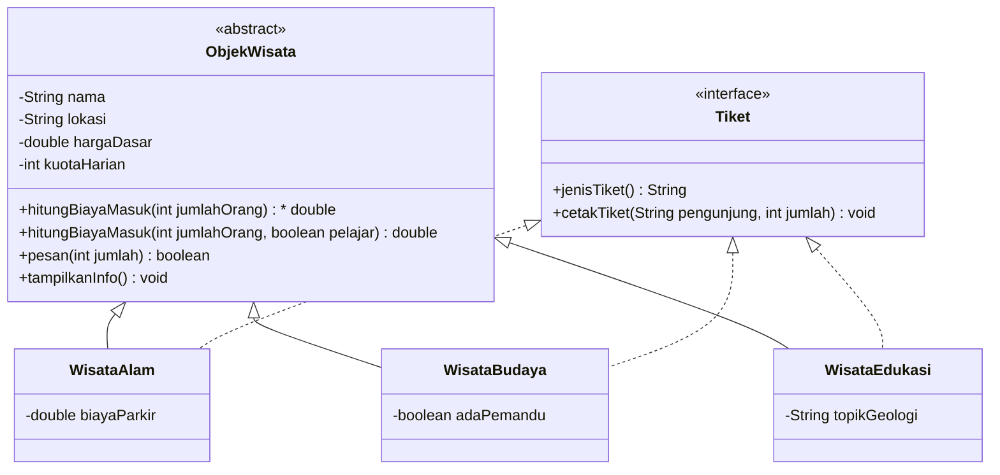

# Sistem Tiket Wisata Geopark Kebumen

Program Java berbasis *Object-Oriented Programming* (OOP) mensimulasikan pemesanan dan penghitungan biaya tiket pada beberapa objek wisata di Geopark Kebumen.

## \---

## Daftar Isi

1. [Deskripsi Singkat](#1-deskripsi-singkat)
2. [Struktur File](#2-struktur-file)
3. [Diagram *Class*](#3-diagram-class)
4. [Penerapan Konsep OOP](#4-penerapan-konsep-oop)

   * [4.1 *Encapsulation* (Enkapsulasi)](#41-encapsulation-enkapsulasi)
   * [4.2 *Inheritance* (Pewarisan)](#42-inheritance-pewarisan)
   * [4.3 *Polymorphism* (Polimorfisme)](#43-polymorphism-polimorfisme)
   * [4.4 *Abstract Class*](#44-abstract-class)
   * [4.5 *Interface*](#45-interface)
5. [Objek yang Dibuat di Main](#5-objek-yang-dibuat-di-main)
6. [Output Program](#6-output-program)

\---

## 1\. Deskripsi Singkat

Geopark Kebumen memiliki berbagai jenis objek wisata, yaitu wisata alam, budaya, dan edukasi geologi. Setiap jenis memiliki aturan biaya masuk yang berbeda. Program ini memodelkan hal tersebut dengan konsep OOP, sehingga:

* sifat umum objek wisata (nama, lokasi, harga, kuota) ditulis **sekali** di *superclass*;
* aturan biaya yang khas ditulis terpisah di tiap *subclass*;
* layanan tiket dibuat sebagai kontrak melalui *interface*.

\---

## 2\. Struktur File

|File|Jenis|Keterangan|
|-|-|-|
|`ObjekWisata.java`|*abstract class* (*superclass*)|Cetakan umum semua objek wisata|
|`Tiket.java`|*interface*|Kontrak layanan tiket|
|`WisataAlam.java`|*subclass*|Biaya masuk ditambah biaya parkir|
|`WisataBudaya.java`|*subclass*|Biaya masuk ditambah biaya pemandu|
|`WisataEdukasi.java`|*subclass*|Diskon rombongan ≥ 10 orang|
|`Main.java`|*main class*|Membuat objek dan menjalankan demonstrasi|

\---

## 3\. Diagram *Class*



\---

## 4\. Penerapan Konsep OOP

### 4.1 *Encapsulation* (Enkapsulasi)

Semua atribut pada `ObjekWisata` dideklarasikan `private`, sehingga tidak dapat diubah langsung dari luar *class*. Akses dilakukan melalui *getter* dan *setter*.

```java
private double hargaDasar;

public void setHargaDasar(double hargaDasar) {
    if (hargaDasar >= 0) {
        this.hargaDasar = hargaDasar;
    } else {
        System.out.println("Harga tidak boleh negatif!");
    }
}
```

* *Setter* memvalidasi data (harga tidak boleh negatif, kuota harus lebih dari 0).
* Kuota hanya berkurang melalui method `pesan(int jumlah)`, sehingga perubahan data selalu terkontrol.

### 4.2 *Inheritance* (Pewarisan)

`WisataAlam`, `WisataBudaya`, dan `WisataEdukasi` mewarisi `ObjekWisata` memakai kata kunci `extends`. Setiap *subclass* memanggil *constructor* *superclass* dengan `super(...)`.

```java
public class WisataAlam extends ObjekWisata implements Tiket {
    public WisataAlam(String nama, String lokasi, double hargaDasar,
                      int kuotaHarian, double biayaParkir) {
        super(nama, lokasi, hargaDasar, kuotaHarian);
        this.biayaParkir = biayaParkir;
    }
}
```

Dengan pewarisan, atribut dan method umum (`getNama()`, `pesan()`, dan lainnya) tidak perlu ditulis ulang di tiap *subclass*.

### 4.3 *Polymorphism* (Polimorfisme)

**a. *Overriding*.** *Subclass* menulis ulang method milik *superclass* dengan anotasi `@Override`, misalnya `tampilkanInfo()`, yang tiap *subclass* menambah informasi khasnya.

**b. *Overloading*.** Method `hitungBiayaMasuk` memiliki dua versi dengan nama sama tetapi parameter berbeda:

```java
public abstract double hitungBiayaMasuk(int jumlahOrang);
public double hitungBiayaMasuk(int jumlahOrang, boolean pelajar) { ... }
```

**c. *Runtime polymorphism*.** Objek *subclass* disimpan dalam referensi *superclass*. Java menentukan method yang dijalankan saat program berjalan, sesuai objek aslinya:

```java
ObjekWisata w1 = new WisataAlam("Pantai Menganti", "Ayah", 10000, 500, 5000);
ObjekWisata w3 = new WisataBudaya("Benteng Van der Wijck", "Gombong", 8000, 200, true);

for (ObjekWisata w : daftar) {
    w.hitungBiayaMasuk(12);   // hasil berbeda tergantung jenis objek
}
```

### 4.4 *Abstract Class*

`ObjekWisata` adalah *abstract class* sehingga tidak dapat dibuat objeknya secara langsung. *Class* ini memiliki *abstract method*:

```java
public abstract double hitungBiayaMasuk(int jumlahOrang);
```

Setiap *subclass* **wajib** mengimplementasikannya sesuai aturan masing-masing:

|*Subclass*|Rumus biaya masuk|
|-|-|
|`WisataAlam`|`(hargaDasar × jumlahOrang) + biayaParkir`|
|`WisataBudaya`|`(hargaDasar × jumlahOrang) + 25.000` bila ada pemandu|
|`WisataEdukasi`|`hargaDasar × jumlahOrang`, dikali 0,85 bila `jumlahOrang ≥ 10`|

### 4.5 *Interface*

`Tiket` adalah *interface* yang berisi kontrak layanan tiket:

```java
public interface Tiket {
    String jenisTiket();
    void cetakTiket(String pengunjung, int jumlah);
}
```

Ketiga *subclass* memakai kata kunci `implements Tiket` dan mengisi seluruh method di atas, masing-masing dengan jenis tiket yang berbeda (alam, budaya, edukasi).

\---

## 5\. Objek yang Dibuat di `Main`

|Objek|*Class*|Keterangan|
|-|-|-|
|`w1`|`WisataAlam`|Pantai Menganti|
|`w2`|`WisataAlam`|Goa Jatijajar|
|`w3`|`WisataBudaya`|Benteng Van der Wijck|
|`w4`|`WisataEdukasi`|Karangsambung|

\---

## 6\. Output Program

Pastikan JDK sudah terpasang, lalu simpan semua file `.java` dalam satu folder.

```run
===== SISTEM TIKET WISATA GEOPARK KEBUMEN =====

(Harga dalam program ini hanya contoh simulasi)


\--- 1. Daftar Objek Wisata ---

\[WISATA ALAM]

Nama        : Pantai Menganti

Lokasi      : Ayah

Harga dasar : Rp10.000

Sisa kuota  : 500 orang

Parkir      : Rp5.000


\[WISATA ALAM]

Nama        : Goa Jatijajar

Lokasi      : Ayah

Harga dasar : Rp15.000

Sisa kuota  : 300 orang

Parkir      : Rp5.000


\[WISATA BUDAYA]

Nama        : Benteng Van der Wijck

Lokasi      : Gombong

Harga dasar : Rp8.000

Sisa kuota  : 200 orang

Pemandu     : Tersedia


\[WISATA EDUKASI]

Nama        : Karangsambung

Lokasi      : Karangsambung

Harga dasar : Rp20.000

Sisa kuota  : 100 orang

Topik       : Batuan purba dan tektonik lempeng


\--- 2. Biaya Masuk Rombongan 12 Orang ---

Pantai Menganti = Rp125.000

Goa Jatijajar = Rp185.000

Benteng Van der Wijck = Rp121.000

Karangsambung = Rp204.000


\--- 3. Biaya Masuk 12 Orang (Pelajar, diskon 20%) ---

Karangsambung = Rp163.200


\--- 4. Cetak Tiket (Interface) ---

\[Tiket Wisata Alam] Pantai Menganti | a.n. Nana | 12 orang

\[Tiket Wisata Alam] Goa Jatijajar | a.n. Nana | 12 orang

\[Tiket Wisata Budaya] Benteng Van der Wijck | a.n. Nana | 12 orang

\[Tiket Wisata Edukasi] Karangsambung | a.n. Nana | 12 orang


\--- 5. Encapsulation ---

Harga tidak boleh negatif!

Pemesanan berhasil? true

\[WISATA ALAM]

Nama        : Pantai Menganti

Lokasi      : Ayah

Harga dasar : Rp12.000

Sisa kuota  : 488 orang

Parkir      : Rp5.000

BUILD SUCCESSFUL (total time: 1 second)

```

\---

